# Lab14：树与二叉树——408 历年真题分类练习

> **作业目标**：通过 54 道 408 历年真题（2009–2026）选择题，按题型系统巩固树与二叉树一章的核心内容：二叉树遍历与序列分析、二叉树的性质与顺序存储、树与森林的转换、线索二叉树、哈夫曼树与哈夫曼编码、二叉排序树、平衡二叉树。请先独立作答，再对照课程统一发布的答案与解析核对订正；涉及序列分析的题目，建议先确定根结点，再划分左右子树；涉及树形变换的题目，建议在草稿纸上画出转换后的二叉树。
>
> 本次为纯书面作业，不要求编写程序、不要求截图。全卷按题型分组，不按年份排列，题号后的括号内仍标注真题年份，便于对照复习。
>
> **审核说明**：本次 PR 自动审核会检查 `Lab14.md` 与题图文件是否存在、题图是否被改动，以及每道选择题是否恰好勾选一个选项。自动审核不判断所选选项是否正确，内容正确性将在期末统一检测。空文件、未作答的模板或删改题目、选项的文件不能通过本次审核。

---

## 一、作答说明

1. 全卷共 54 道单项选择题，按题型分为七组，分组与题号如下：

   | 组别 | 题型 | 题号 | 题数 |
   | :--- | :--- | :--- | :---: |
   | 第一组 | 二叉树遍历与序列分析 | 题 1～10 | 10 |
   | 第二组 | 二叉树的性质、完全二叉树与顺序存储 | 题 11～15 | 5 |
   | 第三组 | 树、森林与二叉树的基本性质及转换 | 题 16～26 | 11 |
   | 第四组 | 线索二叉树 | 题 27～29 | 3 |
   | 第五组 | 哈夫曼树与哈夫曼编码 | 题 30～41 | 12 |
   | 第六组 | 二叉排序树 | 题 42～46 | 5 |
   | 第七组 | 平衡二叉树 | 题 47～54 | 8 |

2. 作答时将所选选项前的 `[ ]` 改为 `[x]`，每题只能勾选一项；不要删除其他选项，不要改动题面、选项顺序和题图。
3. 答案与解析不在本文件中，由课程统一发布；先独立完成，再核对订正。
4. 部分题目的四个选项本身是树形图，图中已标出 A、B、C、D，请对照选项前的字母勾选。
5. 判断遍历序列、树形转换或旋转结果时，建议在草稿纸上逐步画出每一步的树形，不要只凭印象作答。
6. 本次不涉及编程、不涉及截图，也不需要运行任何程序。

> **高度约定**：本卷凡涉及“树的高度”，一律按“单结点高度为 1”计算（根结点高度为 1，叶结点高度为 1），不采用邓俊辉教材中“单结点高度为 0”的定义；相关题目下均另附提示。

---

## 二、二叉树遍历与序列分析（题 1～10）

### 题 1（2009 年）

给定二叉树如右图所示。设 N 代表二叉树的根，L 代表根结点的左子树，R 代表根结点的右子树。若遍历后的结点序列是 3，1，7，5，6，2，4，则其遍历方式是（ ）。

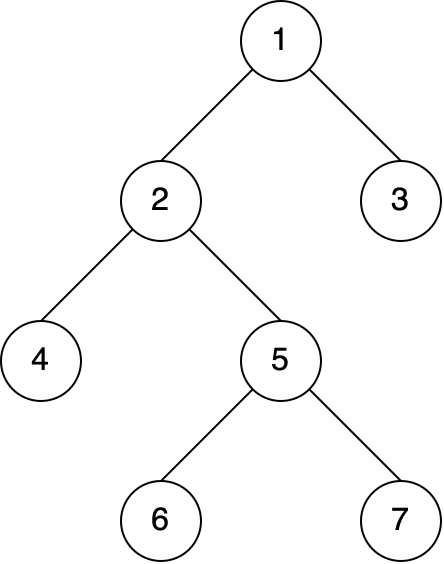

- [ ] A. LRN
- [ ] B. NRL
- [ ] C. RLN
- [x] D. RNL

### 题 2（2011 年）

若一棵二叉树的前序遍历序列和后序遍历序列分别为 1, 2, 3, 4 和 4, 3, 2, 1，则该二叉树的中序遍历序列不会是（ ）。

- [ ] A. 1, 2, 3, 4
- [ ] B. 2, 3, 4, 1
- [x] C. 3, 2, 4, 1
- [ ] D. 4, 3, 2, 1

### 题 3（2012 年）

若一棵二叉树的前序遍历序列为 a, e, b, d, c，后序遍历序列为 b, c, d, e, a，则根结点的孩子结点（ ）。

- [x] A. 只有 e
- [ ] B. 有 e、b
- [ ] C. 有 e、c
- [ ] D. 无法确定

### 题 4（2015 年）

先序序列为 a, b, c, d 的不同二叉树的个数是（ ）。

- [ ] A. 13
- [x] B. 14
- [ ] C. 15
- [ ] D. 16

### 题 5（2017 年）

要使一棵非空二叉树的先序序列与中序序列相同，其所有非叶结点须满足的条件是（ ）。

- [ ] A. 只有左子树
- [x] B. 只有右子树
- [ ] C. 结点的度均为 1
- [ ] D. 结点的度均为 2

### 题 6（2017 年）

已知一棵二叉树的树形如下图所示，其后序序列为 e, a, c, b, d, g, f，树中与结点 a 同层的结点是（ ）。

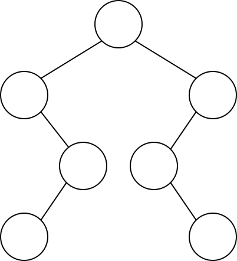

- [ ] A. c
- [x] B. d
- [ ] C. f
- [ ] D. g

### 题 7（2022 年）

若结点 p 与 q 在二叉树 T 的中序遍历序列中相邻，且 p 在 q 之前，则下列 p 与 q 的关系中，不可能的是（ ）。

I. q 是 p 的双亲
II. q 是 p 的右孩子
III. q 是 p 的右兄弟
IV. q 是 p 的双亲的双亲

- [ ] A. 仅 I
- [x] B. 仅 III
- [ ] C. 仅 II、III
- [ ] D. 仅 II、IV

### 题 8（2023 年）

已知一棵二叉树的树形如图，若其后序遍历为 f, d, b, e, c, a，则其先序序列为（ ）。

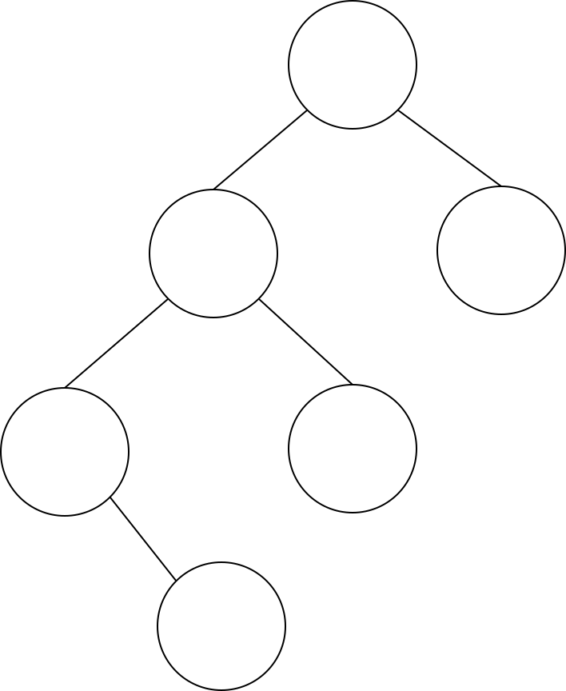

- [x] A. aedfbc
- [ ] B. acebdf
- [ ] C. cabefd
- [ ] D. dfebac

### 题 9（2024 年）

p、q、v 都是二叉树 T 中的结点，二叉树 T 的中序遍历为 ···, p, v, q, ···，其中 v 有两个孩子结点，则下列说法正确的是（ ）。

- [x] A. p 没右孩子，q 没左孩子
- [ ] B. p 没右孩子，q 有左孩子
- [ ] C. p 有右孩子，q 没左孩子
- [ ] D. p 有右孩子，q 有左孩子

### 题 10（2026 年）

已知二叉树 T 的中序遍历为 b, e, d, f, c, a, g，层序遍历为 a, b, g, c, d, e, f，则其后序遍历序列为（ ）。

- [ ] A. c, e, d, f, b, g, a
- [ ] B. c, e, f, d, b, g, a
- [x] C. e, f, d, c, b, g, a
- [ ] D. e, g, f, d, b, c, a

---

## 三、二叉树的性质、完全二叉树与顺序存储（题 11～15）

### 题 11（2009 年）

已知一棵完全二叉树的第 6 层（设根为第 1 层）有 8 个叶结点，则该完全二叉树的结点个数最多是（ ）。

- [ ] A. 39
- [ ] B. 52
- [x] C. 111
- [ ] D. 119

### 题 12（2011 年）

若一棵完全二叉树有 768 个结点，则该二叉树中叶结点的个数是（ ）。

- [ ] A. 257
- [ ] B. 258
- [x] C. 384
- [ ] D. 385

### 题 13（2018 年）

设一棵非空完全二叉树 T 的所有叶结点均位于同一层，且每个非叶结点都有 2 个子结点。若 T 有 k 个叶结点，则 T 的结点总数是（ ）。

- [x] A. 2k−1
- [ ] B. 2k
- [ ] C. k²
- [ ] D. 2ᵏ−1

### 题 14（2020 年）

对于任意一棵高度为 5 且有 10 个结点的二叉树，若采用顺序存储结构保存，每个结点占 1 个存储单元（仅存放结点的数据信息），则存放该二叉树需要的存储单元数量至少是（ ）。

> **高度约定**：本题按“单结点高度为 1”计算（根结点高度为 1，叶结点高度为 1），不采用邓俊辉教材“单结点高度为 0”的定义。

- [ ] A. 31
- [x] B. 16
- [ ] C. 15
- [ ] D. 10

### 题 15（2025 年）

若二叉树的结点值均为正整数，采用顺序存储方式保存在数组 R 中，用 -1 表示结点不存在，则下列数组中，不能表示一棵二叉树的是（ ）。

- [ ] A. `R[] = {20, 15, 40, -1, -1, 35}`
- [ ] B. `R[] = {15, 40, 10, 18, 35, -1, -1}`
- [ ] C. `R[] = {15, 40, 10, -1, -1, -1, 12}`
- [x] D. `R[] = {17, 20, 35, -1, 18, 45, -1, -1, 19, 27}`

---

## 四、树、森林与二叉树的基本性质及转换（题 16～26）

### 题 16（2009 年）

将森林转换为对应的二叉树，若在二叉树中，结点 u 是结点 v 的父结点的父结点，则在原来的森林中，u 和 v 可能具有的关系是（ ）。

I. 父子关系
II. 兄弟关系
III. u 的父结点与 v 的父结点是兄弟关系

- [ ] A. 只有 II
- [ ] B. I 和 II
- [ ] C. I 和 III
- [x] D. I、II 和 III

### 题 17（2010 年）

在一棵度数为 4 的树 T 中，若有 20 个度为 4 的结点，10 个度为 3 的结点，1 个度为 2 的结点，10 个度为 1 的结点，则树 T 的叶结点个数是（ ）。

- [ ] A. 41
- [x] B. 82
- [ ] C. 113
- [ ] D. 122

### 题 18（2011 年）

已知一棵有 2011 个结点的树，其叶结点个数为 116，该树对应的二叉树中无右孩子的结点个数是（ ）。

- [ ] A. 115
- [ ] B. 116
- [ ] C. 1895
- [x] D. 1896

### 题 19（2014 年）

将森林 F 转换为对应的二叉树 T，F 中叶子的个数等于（ ）。

- [ ] A. T 中叶结点的个数
- [ ] B. T 中度为 1 的结点个数
- [x] C. T 中左孩子指针为空的结点个数
- [ ] D. T 中右孩子指针为空的结点个数

### 题 20（2016 年）

若森林 F 有 15 条边、25 个结点，则 F 包含树的个数是（ ）。

- [ ] A. 8
- [ ] B. 9
- [x] C. 10
- [ ] D. 11

### 题 21（2019 年）

若将一棵树 T 转化为对应的二叉树 BT，则下列对 BT 的遍历中，其遍历序列与 T 的后根遍历序列相同的是（ ）。

- [ ] A. 先序遍历
- [x] B. 中序遍历
- [ ] C. 后序遍历
- [ ] D. 按层遍历

### 题 22（2020 年）

已知森林 F 及与之对应的二叉树 T，若 F 的先根遍历序列是 a, b, c, d, e, f，中根遍历序列是 b, a, d, f, e, c，则 T 的后根遍历序列是（ ）。

- [ ] A. b, a, d, f, e, c
- [ ] B. b, d, f, e, c, a
- [x] C. b, f, e, d, c, a
- [ ] D. f, e, d, c, b, a

### 题 23（2021 年）

某森林 F 对应的二叉树为 T，若 T 的先序遍历序列是 a, b, d, c, e, g, f，中序遍历序列是 b, d, a, e, g, c, f，则 F 中树的棵数是（ ）。

- [ ] A. 1
- [ ] B. 2
- [x] C. 3
- [ ] D. 4

### 题 24（2022 年）

若三叉树 T 中有 244 个结点（叶结点的高度为 1），则 T 的高度至少是（ ）。

> **高度约定**：本题按“单结点高度为 1”计算（根结点高度为 1，叶结点高度为 1），不采用邓俊辉教材“单结点高度为 0”的定义。

- [ ] A. 8
- [ ] B. 7
- [x] C. 6
- [ ] D. 5

### 题 25（2025 年）

下列关于二叉树及森林的叙述中，正确的是（ ）。

- [ ] A. 完全二叉树不存在度为 1 的结点
- [x] B. 任意一个森林可以转换为一棵二叉树
- [ ] C. 二叉树的分支结点个数比叶结点个数少
- [ ] D. 链式树的根中保存的是最先计算的运算符

### 题 26（2026 年）

森林 F 中有 5 棵树，其结点个数分别为 2、3、4、5、7，森林中树的次序可以任意，问 F 对应的二叉树最小高度为多少？

> **高度约定**：本题按“单结点高度为 1”计算（根结点高度为 1，叶结点高度为 1），不采用邓俊辉教材“单结点高度为 0”的定义。

- [ ] A. 5
- [x] B. 6
- [ ] C. 8
- [ ] D. 10

---

## 五、线索二叉树（题 27～29）

### 题 27（2010 年）

下列线索二叉树中（用虚线表示线索），符合后序线索树定义的是（ ）。

- [ ] A. 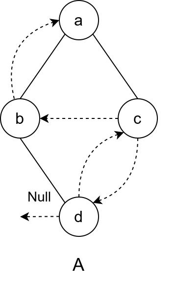
- [ ] B. 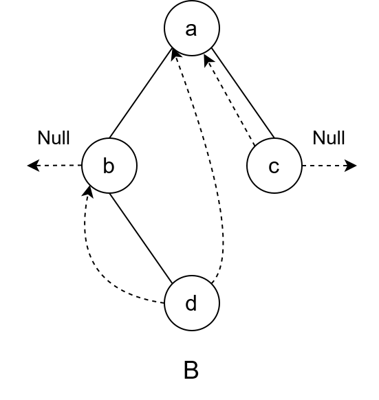
- [ ] C. 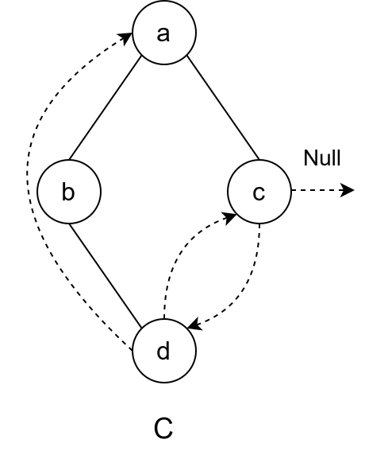
- [x] D. 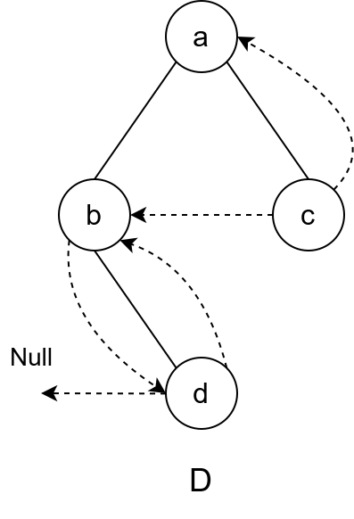

### 题 28（2013 年）

若 X 是后序线索二叉树中的叶结点，且 X 存在左兄弟结点 Y，则 X 的右线索指的是（ ）。

- [x] A. X 的父结点
- [ ] B. 以 Y 为根的子树的最左下结点
- [ ] C. X 的左兄弟结点 Y
- [ ] D. 以 Y 为根的子树的最右下结点

### 题 29（2014 年）

若对如下的二叉树进行中序线索化，则结点 x 的左、右线索指向的结点分别是（ ）。

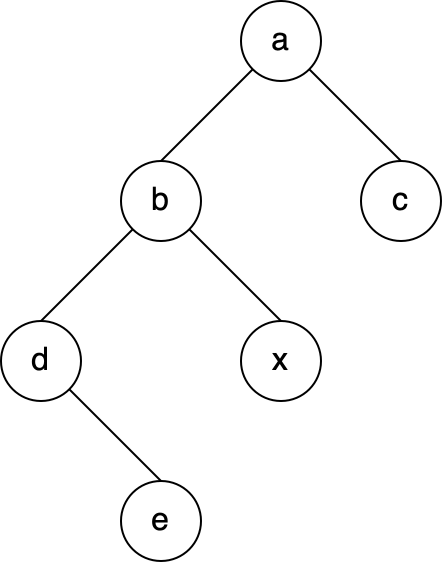

- [ ] A. e、c
- [ ] B. e、a
- [ ] C. d、c
- [x] D. b、a

---

## 六、哈夫曼树与哈夫曼编码（题 30～41）

### 题 30（2010 年）

对 n（n≥2）个权值均不相同的字符构成哈夫曼树。下列关于该哈夫曼树的叙述中，错误的是（ ）。

- [x] A. 该树一定是一棵完全二叉树
- [ ] B. 树中一定没有度为 1 的结点
- [ ] C. 树中两个权值最小的结点一定是兄弟结点
- [ ] D. 树中任一非叶结点的权值一定不小于下一层任一结点的权值

### 题 31（2013 年）

已知三叉树 T 中 6 个叶结点的权分别是 2, 3, 4, 5, 6, 7，T 的带权（外部）路径长度最小是（ ）。

- [ ] A. 27
- [x] B. 46
- [ ] C. 54
- [ ] D. 56

### 题 32（2014 年）

5 个字符有如下 4 种编码方案，不是前缀编码的是（ ）。

- [ ] A. 01, 0000, 0001, 001, 1
- [ ] B. 011, 000, 001, 010, 1
- [ ] C. 000, 001, 010, 011, 100
- [x] D. 0, 100, 110, 1110, 1100

### 题 33（2015 年）

下列选项给出的是从根分别到达两个叶结点路径上的权值序列，能属于同一棵哈夫曼树的是（ ）。

- [ ] A. 24, 10, 5 和 24, 10, 7
- [ ] B. 24, 10, 5 和 24, 12, 7
- [ ] C. 24, 10, 10 和 24, 14, 11
- [x] D. 24, 10, 5 和 24, 14, 6

### 题 34（2017 年）

已知字符集 {a, b, c, d, e, f, g, h}，若各字符的哈夫曼编码依次是 0100, 10, 0000, 0101, 001, 011, 11, 0001，则编码序列 0100011001001011110101 的译码结果是（ ）。

- [ ] A. a c g a b f h
- [ ] B. a d b a g b b
- [ ] C. a f b e a g d
- [x] D. a f e e f g d

### 题 35（2018 年）

已知字符集 {a, b, c, d, e, f}，若各字符出现的次数分别为 6, 3, 8, 2, 10, 4，则对应字符集中各字符的哈夫曼编码可能是（ ）。

- [x] A. 00, 1011, 01, 1010, 11, 100
- [ ] B. 00, 100, 110, 000, 0010, 01
- [ ] C. 10, 1011, 11, 0011, 00, 010
- [ ] D. 0011, 10, 11, 0010, 01, 000

### 题 36（2019 年）

对 n 个互不相同的符号进行哈夫曼编码。若生成的哈夫曼树共有 115 个结点，则 n 的值是（ ）。

- [ ] A. 56
- [ ] B. 57
- [x] C. 58
- [ ] D. 60

### 题 37（2021 年）

若某二叉树有 5 个叶结点，其权值分别为 10、12、16、21、30，则其最小的带权路径长度（WPL）是（ ）。

- [ ] A. 89
- [x] B. 200
- [ ] C. 208
- [ ] D. 289

### 题 38（2022 年）

对任意给定的含 n（n > 2）个字符的有限集 S，用二叉树表示 S 的哈夫曼编码集和定长编码集，分别得到二叉树 T1 和 T2。下列叙述中，正确的是（ ）。

> **高度约定**：本题按“单结点高度为 1”计算（根结点高度为 1，叶结点高度为 1），不采用邓俊辉教材“单结点高度为 0”的定义。

- [ ] A. T1 与 T2 的结点数相同
- [ ] B. T1 的高度大于 T2 的高度
- [ ] C. 出现频次不同的字符在 T1 中处于不同的层
- [x] D. 出现频次不同的字符在 T2 中处于相同的层

### 题 39（2023 年）

由 6 个字符组成的字符集 S 中，各个字符出现的频次分别为 3, 4, 5, 6, 8, 10，为 S 构造的哈夫曼树的加权平均长度为（ ）。

- [ ] A. 2.4
- [x] B. 2.5
- [ ] C. 2.67
- [ ] D. 2.75

### 题 40（2025 年）

设字符集 S 包含 7 个字符，各字符出现的频次分别是 2, 3, 4, 6, 8, 10, 11。为 S 中的各字符构造哈夫曼编码，编码长度不小于 3 的字符个数是（ ）。

- [ ] A. 2
- [ ] B. 3
- [ ] C. 4
- [x] D. 5

### 题 41（2026 年）

假设二叉树中结点权值为 a=1, b=2, c=4, d=5, e=8, f=10, g=12。当带权路径长度（WPL）最小时，与结点 e（权值 8）处于相同深度的结点是哪些？

- [ ] A. d
- [ ] B. g
- [ ] C. d, f
- [x] D. f, g

---

## 七、二叉排序树（题 42～46）

### 题 42（2011 年）

对于下列关键字序列，不可能构成某二叉排序树中一条查找路径的序列是（ ）。

- [x] A. 95，22，91，24，94，71
- [ ] B. 92，20，91，34，88，35
- [ ] C. 21，89，77，29，36，38
- [ ] D. 12，25，71，68，33，34

### 题 43（2013 年）

在任意一棵非空二叉排序树 T1 中，删除某结点 v 之后形成二叉排序树 T2，再将 v 插入 T2 形成二叉排序树 T3。下列关于 T1 与 T3 的叙述中，正确的是（ ）。

I. 若 v 是 T1 的叶结点，则 T1 与 T3 不同
II. 若 v 是 T1 的叶结点，则 T1 与 T3 相同
III. 若 v 不是 T1 的叶结点，则 T1 与 T3 不同
IV. 若 v 不是 T1 的叶结点，则 T1 与 T3 相同

- [ ] A. 仅 I、III
- [ ] B. 仅 I、IV
- [x] C. 仅 II、III
- [ ] D. 仅 II、IV

### 题 44（2018 年）

已知二叉排序树如下图所示，元素之间应满足的大小关系是（ ）。

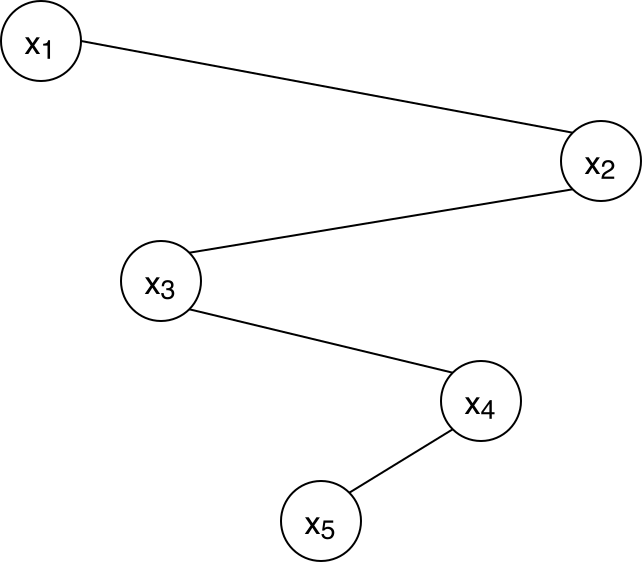

- [ ] A. x₁ < x₂ < x₃
- [ ] B. x₁ < x₄ < x₅
- [x] C. x₃ < x₅ < x₄
- [ ] D. x₄ < x₃ < x₅

### 题 45（2020 年）

下列给定的关键字输入序列中，不能生成如下二叉排序树的是（ ）。

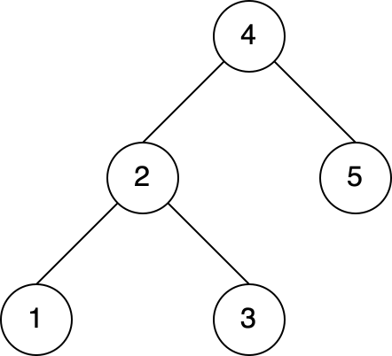

- [ ] A. 4，5，2，1，3
- [x] B. 4，5，1，2，3
- [ ] C. 4，2，5，3，1
- [ ] D. 4，2，1，3，5

### 题 46（2024 年）

一棵二叉搜索树如下图所示，K1、K2、K3 分别是对应结点中保存的关键字，三角形表示子树。则子树 T 中任一结点中保存的关键字 X 满足的是（ ）。

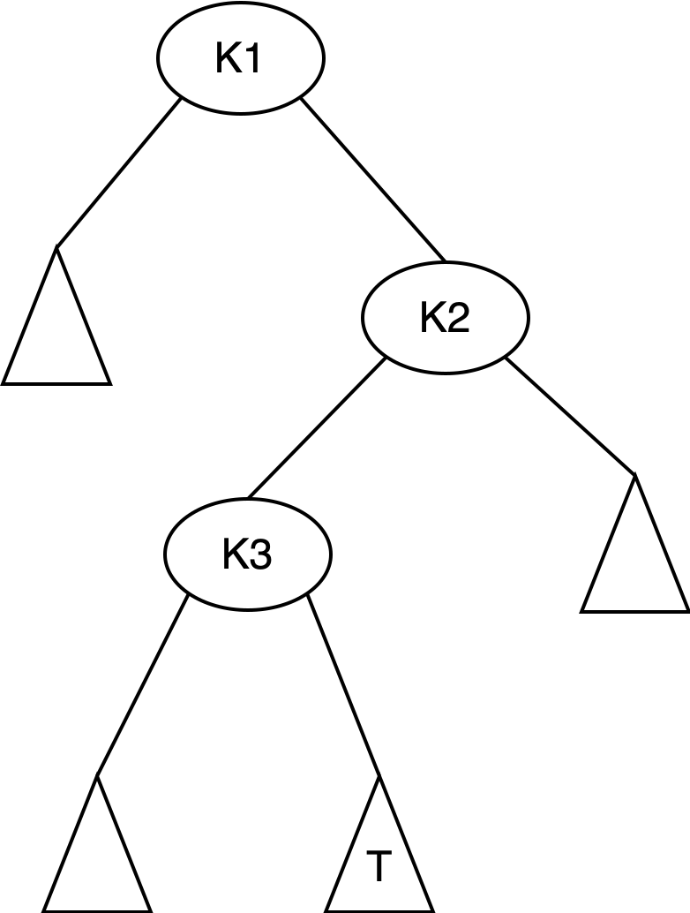

- [ ] A. X < K₁
- [ ] B. X > K₂
- [ ] C. K₁ < X < K₃
- [x] D. K₃ < X < K₂

---

## 八、平衡二叉树（题 47～54）

### 题 47（2009 年）

下列二叉排序树中，满足平衡二叉树定义的是（ ）。

- [ ] A. 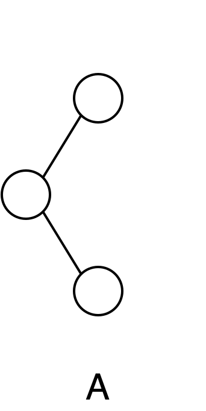
- [x] B. 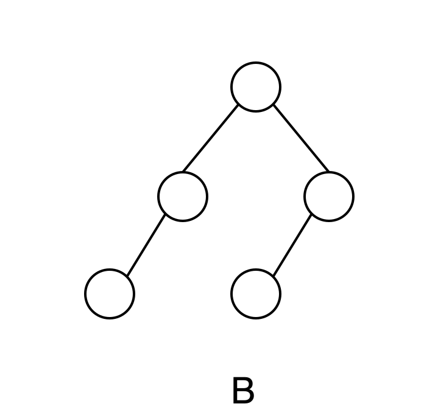
- [ ] C. 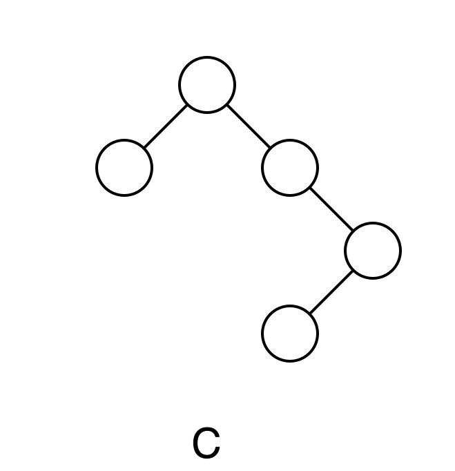
- [ ] D. 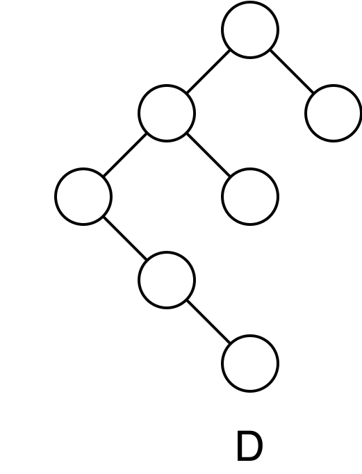

### 题 48（2010 年）

在下图所示的平衡二叉树中，插入关键字 48 后得到一棵新平衡二叉树。在新平衡二叉树中，关键字 37 所在结点的左、右子结点中保存的关键字分别是（ ）。

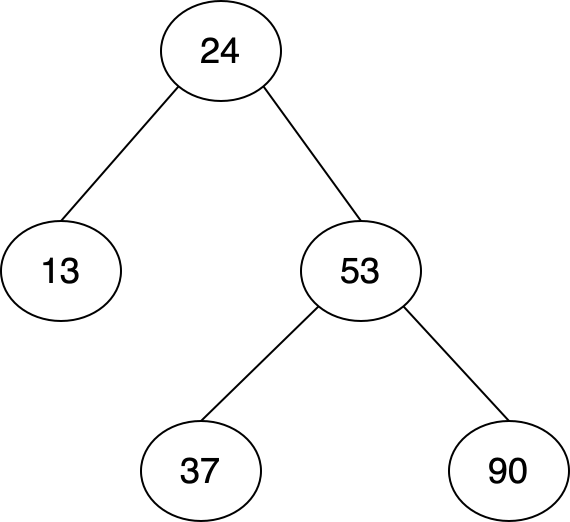

- [ ] A. 13, 48
- [ ] B. 24, 48
- [x] C. 24, 53
- [ ] D. 24, 90

### 题 49（2012 年）

若平衡二叉树的高度为 6，且所有非叶结点的平衡因子均为 1，则该平衡二叉树的结点总数为（ ）。

> **高度约定**：本题按“单结点高度为 1”计算（根结点高度为 1，叶结点高度为 1），不采用邓俊辉教材“单结点高度为 0”的定义。

- [ ] A. 10
- [x] B. 20
- [ ] C. 32
- [ ] D. 33

### 题 50（2013 年）

若将关键字 1, 2, 3, 4, 5, 6, 7 依次插入到初始为空的平衡二叉树 T 中，则 T 中平衡因子为 0 的分支结点的个数是（ ）。

- [ ] A. 0
- [ ] B. 1
- [ ] C. 2
- [x] D. 3

### 题 51（2015 年）

现有一棵无重复关键字的平衡二叉树（AVL 树），对其进行中序遍历可得到一个降序序列。下列关于该平衡二叉树的叙述中，正确的是（ ）。

- [ ] A. 根结点的度一定为 2
- [ ] B. 树中最小元素一定是叶结点
- [ ] C. 最后插入的元素一定是叶结点
- [x] D. 树中最大元素一定是无左子树

### 题 52（2019 年）

在任意一棵非空平衡二叉树（AVL 树）T1 中，删除某结点 v 之后形成平衡二叉树 T2，再将 v 插入 T2 形成平衡二叉树 T3。下列关于 T1 与 T3 的叙述中，正确的是（ ）。

I. 若 v 是 T1 的叶结点，则 T1 与 T3 可能不相同
II. 若 v 不是 T1 的叶结点，则 T1 与 T3 一定不相同
III. 若 v 不是 T1 的叶结点，则 T1 与 T3 一定相同

- [ ] A. 仅 I
- [ ] B. 仅 II
- [x] C. 仅 I、II
- [ ] D. 仅 I、III

### 题 53（2021 年）

给定平衡二叉树如下图所示，插入关键字 23 后，根中的关键字是（ ）。

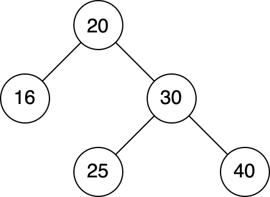

- [ ] A. 16
- [ ] B. 20
- [ ] C. 23
- [x] D. 25

### 题 54（2026 年）

已知平衡二叉树（AVL 树）的定义为：树中任意一个结点的左右子树的高度差的绝对值不超过 1，且左右子树均为平衡二叉树。若某平衡二叉树的高度为 4（根结点的高度记为 1），则其根结点的左右子树的结点数之差最多为（ ）。

> **高度约定**：本题按“单结点高度为 1”计算（根结点高度为 1，叶结点高度为 1），不采用邓俊辉教材“单结点高度为 0”的定义。

- [ ] A. 1
- [ ] B. 2
- [ ] C. 3
- [x] D. 5

---

## 九、提交要求

将本文件复制到自己的 `学号姓名/Lab14/Lab14.md`，完成全部选择题作答。最终只提交以下文件：

```text
学号姓名/
└── Lab14/
    ├── Lab14.md
    └── imgs/
        ├── 2009_q3_stem1.png
        ├── 2009_q4_A.png
        ├── 2009_q4_B.png
        ├── 2009_q4_C.png
        ├── 2009_q4_D.png
        ├── 2010_q3_A.png
        ├── 2010_q3_B.png
        ├── 2010_q3_C.png
        ├── 2010_q3_D.png
        ├── 2010_q4_stem1.png
        ├── 2014_q4_stem1.png
        ├── 2017_q5_stem1.png
        ├── 2018_q6_stem1.png
        ├── 2020_q5_stem1.png
        ├── 2021_q6_stem1.png
        ├── 2023_q5_stem1.png
        └── 2024_q7_stem1.png
```

- `imgs/` 中共有 17 张题图，须从 `homework/Lab14/imgs/` 原样复制，不得修改、重命名或替换；缺少任一题图文件，或改动 `Lab14.md` 中的图片引用路径，均判为不完整。
- 每道单项选择题必须且只能将一个选项的 `[ ]` 改为 `[x]`，全卷恰好 54 处 `[x]`；不能全部不选，也不能同时选择多项。
- `Lab14.md` 必须保留全部 54 道题目与全部选项（共 216 个选项），不要改动题面、选项顺序和题图引用路径。
- 答案与解析由课程统一发布，提交的文件中不要自行添加答案、答案速查表或解析。
- 不需要提交程序、截图、`CMakeLists.txt`、`cmake-build-*`、`.idea/`、`.exe` 或其他编译产物。
- `Lab14`、`Lab14.md` 的大小写必须完全一致。
- PR 标题必须严格使用 `[学号姓名]Lab14作业提交`，右方括号后不能有空格。
- 一个 PR 只能包含本次 Lab14 的文件，不得修改其他同学、`homework/`、README 或仓库配置。

---

## 十、截止时间

**2026 年 10 月 29 日 24:00（即 2026 年 10 月 30 日 00:00，北京时间）**

以 GitHub 记录的最后一次向 PR 推送代码的时间为准。不晚于上述时刻创建 PR 并完成最后一次推送不算超时；超过该时刻新建 PR，或向已有 PR 推送任何修改，均算作超时。审核未通过的同学请在截止前完成修改。
