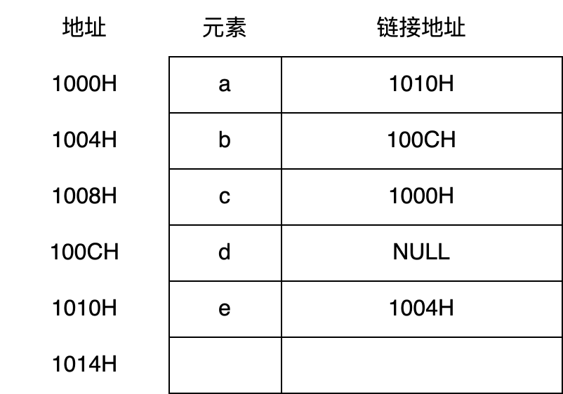

# Lab13：顺序表、链表、数组与循环队列——408 历年真题选择练习

> **作业目标**：通过 15 道 408 历年真题（2011–2026）选择题，巩固顺序表、链表、数组与循环队列的核心内容：顺序表的随机存取与元素移动、单链表 / 双向链表 / 循环链表的指针操作、二维数组与特殊矩阵压缩存储的下标计算，以及循环队列的队空、队满判定。请先独立作答，再对照课程统一发布的答案与解析核对订正；涉及指针操作的题目，建议在草稿纸上画出结点链接的变化过程；涉及下标计算的题目，建议先写出行（列）优先的累加式再代入数值。
>
> 本次为纯书面作业，不要求编写程序、不要求截图。中缀表达式转后缀表达式、栈与出入栈序列相关的题目不在本次范围内。
>
> **审核说明**：本次 PR 自动审核会检查 `Lab13.md` 与题图文件是否存在、题图是否被改动，以及每道选择题是否恰好勾选一个选项。自动审核不判断所选选项是否正确，内容正确性将在期末统一检测。空文件、未作答的模板或删改题目、选项的文件不能通过本次审核。

---

## 一、作答说明

1. 全卷共 15 道单项选择题，按考点分为四组；题号后的括号内为真题年份，便于对照历年真题复习。
2. 作答时将所选选项前的 `[ ]` 改为 `[x]`，每题只能勾选一项；不要删除其他选项，不要改动题面、选项顺序和题图。
3. 答案与解析不在本文件中，由课程统一发布；先独立完成，再核对订正。
4. 判断链表操作是否正确时，建议在草稿纸上标出 `prev`、`next` 的指向变化；计算矩阵元素下标时，先确定存储区域、优先次序以及下标是否从 0 开始，再逐行（列）累加。
5. 本次不涉及编程、不涉及截图，也不需要运行任何程序。

---

## 二、顺序表（题 1～2）

### 题 1（2023 年）

下列对顺序存储的有序表（长度为 n）实现给定操作的算法中平均时间复杂度为 O(1) 的是（ ）。

- [ ] A. 查找包含指定值元素的算法
- [ ] B. 插入包含指定值元素的算法
- [ ] C. 删除第 i 个元素的算法
- [x] D. 获取第 i 个值的算法

### 题 2（2026 年）

当存储空间有足够的空闲空间时，在保持表内元素顺序相对不变的情况下，下列哪些操作会必然导致产生移动次数（ ）。

I. 表头插入一个元素
II. 表头删除一个元素
III. 表尾插入一个元素
IV. 表尾删除一个元素

- [x] A. I、II
- [ ] B. I、III
- [ ] C. II、IV
- [ ] D. III、IV

---

## 三、链表（题 3～9）

### 题 3（2013 年）

已知两个长度分别为 m 和 n 的升序链表，若将它们合并为一个长度为 m+n 的降序链表，则最坏情况下的时间复杂度是（ ）。

- [ ] A. O(n)
- [ ] B. O(m×n)
- [ ] C. O(min(m,n))
- [x] D. O(max(m,n))

### 题 4（2016 年）

已知表头元素为 c 的单链表在内存中的存储状态如下表所示。现将 f 存放于 1014H 处并插入单链表，若 f 在逻辑上位于 a 和 e 之间，则 a, e, f 的“链接地址”依次是（ ）。



- [ ] A. 1010H，1014H，1004H
- [ ] B. 1010H，1004H，1014H
- [ ] C. 1014H，1010H，1004H
- [x] D. 1014H，1004H，1010H

### 题 5（2016 年）

已知一个带有表头结点的双向循环链表 L，结点结构为 `prev | data | next`，`prev` 和 `next` 分别是指向其直接前驱和直接后继结点的指针。现要删除指针 p 所指的结点，正确的语句序列是（ ）。

- [ ] A. p->next->prev = p->prev; p->prev->next = p->prev; free(p);
- [ ] B. p->next->prev = p->next; p->prev->next = p->next; free(p);
- [ ] C. p->next->prev = p->next; p->prev->next = p->prev; free(p);
- [x] D. p->next->prev = p->prev; p->prev->next = p->next; free(p);

### 题 6（2021 年）

已知头指针 h 指向一个带头结点的非空单循环链表，结点结构为


其中 `next` 是指向直接后继结点的指针，p 是尾指针，q 是临时指针。现要删除该链表的第一个元素，正确的语句序列是（ ）。

- [ ] A. h->next = h->next->next; q = h->next; free(q);
- [ ] B. q = h->next; h->next = h->next->next; free(q);
- [x] C. q = h->next; h->next = q->next; if (p != q) p = h; free(q);
- [ ] D. q = h->next; h->next = q->next; if (p == q) p = h; free(q);

### 题 7（2023 年）

现有非空双向链表 L，其结点结构为：


`prev` 是指向直接前驱结点的指针，`next` 是指向直接后继结点的指针。若要在 L 中指针 p 所指向的结点（非尾结点）之后插入指针 s 指向的新结点，则在执行了语句序列：`s->next = p->next; p->next = s;` 后，还要执行（ ）。

- [ ] A. s->next->prev = p; s->prev = p;
- [x] B. p->next->prev = s; s->prev = p;
- [ ] C. s->prev = s->next->prev; s->next->prev = s;
- [ ] D. p->next->prev = s->prev; s->next->prev = p;

### 题 8（2024 年）

已知带头结点的非空单链表 L 的头指针为 h，指针 p 指向 L 中间的一个链表结点（不是第一个和最后一个结点）。q = p->next，p->next = q->next，q->next = h->next，h->next = q。这段代码的功能是（ ）。

- [ ] A. 把 q 指向的结点插入到 p 的后面
- [ ] B. 把 p 指向的结点插入到 q 的后面
- [ ] C. 把 p 指向的结点插入到 h 的后面
- [x] D. 把 q 指向的结点插入到 h 的后面

### 题 9（2026 年）

设有一个双向链表 L，结构为 `[p2, p1]`，头结点为 head。初始时 head = cu。现要将每个结点的 p2 指向 p1 指向结点的直接后继，应该进行的操作是（ ）。

- [ ] A. `while(cu != NULL) { cu->p2 = cu->p1->p1; cu = cu->p1; }`
- [ ] B. `while(cu != NULL && cu->p2 != NULL) { cu->p2 = cu->p1->p1; cu = cu->p1; }`
- [ ] C. `while(cu != NULL) { if (cu->p1 != NULL) { cu->p2 = cu->p1->p1; cu = cu->p1; } }`
- [x] D. `while(cu != NULL) { if (cu->p1 != NULL) { cu->p2 = cu->p1->p1; } else { cu->p2 = NULL; } cu = cu->p1; }`

---

## 四、数组与特殊矩阵（题 10～13）

### 题 10（2016 年）

有一个 100 阶的三对角矩阵 M，其元素 m_{i,j}（1≤i≤100，1≤j≤100）按行优先依次压缩存入下标从 0 开始的一维数组 N 中。元素 m_{30,30} 在数组 N 中的下标是（ ）。

- [ ] A. 86
- [x] B. 87
- [ ] C. 88
- [ ] D. 89

### 题 11（2018 年）

设有一个 12×12 的对称矩阵 M，将其上三角部分的元素 m_{i,j}（1≤i≤j≤12）按行优先存入 C 语言的一维数组 N 中，元素 m_{6,6} 在 N 中的下标是（ ）。

- [x] A. 50
- [ ] B. 51
- [ ] C. 55
- [ ] D. 66

### 题 12（2020 年）

将一个 10×10 对称矩阵 M 的上三角部分的元素 m_{i,j}（1≤i≤j≤10），按列优先存入 C 语言的一维数组 N 中，元素 m_{7,2} 在 N 中的下标是（ ）。

- [ ] A. 15
- [ ] B. 16
- [x] C. 22
- [ ] D. 23

### 题 13（2021 年）

已知二维数组 A 按行优先方式存储，每个元素占用 1 个存储单元。若元素 A[0][0] 的存储地址是 100，A[3][3] 的存储地址是 220，则元素 A[5][5] 的存储地址是（ ）。

- [ ] A. 295
- [x] B. 300
- [ ] C. 301
- [ ] D. 306

---

## 五、循环队列（题 14～15）

### 题 14（2011 年）

已知循环队列存储在一维数组 A[0..n-1] 中，且队列非空时 front 和 rear 分别指向队头元素和队尾元素。若初始时队列空，且要求第一个进入队列的元素存储在 A[0] 处，则初始时 front 和 rear 的值分别是（ ）。

- [ ] A. 0，0
- [x] B. 0，n-1
- [ ] C. n-1，0
- [ ] D. n-1，n-1

### 题 15（2014 年）

循环队列放在一维数组 A[0..M-1] 中，end1 指向队头元素，end2 指向队尾元素的后一个位置。假设队列两端均可进行入队和出队操作，队列中最多能容纳 M-1 个元素。初始时为空。下列判断队空和队满的条件中，正确的是（ ）。

- [x] A. 队空：end1 == end2；队满：end1 == (end2 + 1) mod M
- [ ] B. 队空：end1 == end2；队满：end2 == (end1 + 1) mod (M - 1)
- [ ] C. 队空：end2 == (end1 + 1) mod M；队满：end1 == (end2 + 1) mod M
- [ ] D. 队空：end1 == (end2 + 1) mod M；队满：end2 == (end1 + 1) mod (M - 1)

---

## 六、提交要求

将本文件复制到自己的 `学号姓名/Lab13/Lab13.md`，完成全部选择题作答。最终只提交以下文件：

```text
学号姓名/
└── Lab13/
    ├── Lab13.md
    └── imgs/
        ├── 2016_q1_stem1.png
        ├── 2021_q1_stem1.png
        └── 2023_q2_stem1.png
```

- `imgs/` 中是题 4、题 6、题 7 的题图，须从 `homework/Lab13/imgs/` 原样复制，不得修改、重命名或替换；缺少题图文件，或改动 `Lab13.md` 中的图片引用路径，均判为不完整。
- 每道单项选择题必须且只能将一个选项的 `[ ]` 改为 `[x]`，全卷恰好 15 处 `[x]`；不能全部不选，也不能同时选择多项。
- `Lab13.md` 必须保留全部 15 道题目与全部选项（共 60 个选项），不要改动题面、选项顺序和题图引用路径。
- 答案与解析由课程统一发布，提交的文件中不要自行添加答案、答案速查表或解析。
- 不需要提交程序、截图、`CMakeLists.txt`、`cmake-build-*`、`.idea/`、`.exe` 或其他编译产物。
- `Lab13`、`Lab13.md` 的大小写必须完全一致。
- PR 标题必须严格使用 `[学号姓名]Lab13作业提交`，右方括号后不能有空格。
- 一个 PR 只能包含本次 Lab13 的文件，不得修改其他同学、`homework/`、README 或仓库配置。

---

## 七、截止时间

**2026 年 10 月 28 日 24:00（即 2026 年 10 月 29 日 00:00，北京时间）**

以 GitHub 记录的最后一次向 PR 推送代码的时间为准。不晚于上述时刻创建 PR 并完成最后一次推送不算超时；超过该时刻新建 PR，或向已有 PR 推送任何修改，均算作超时。审核未通过的同学请在截止前完成修改。
